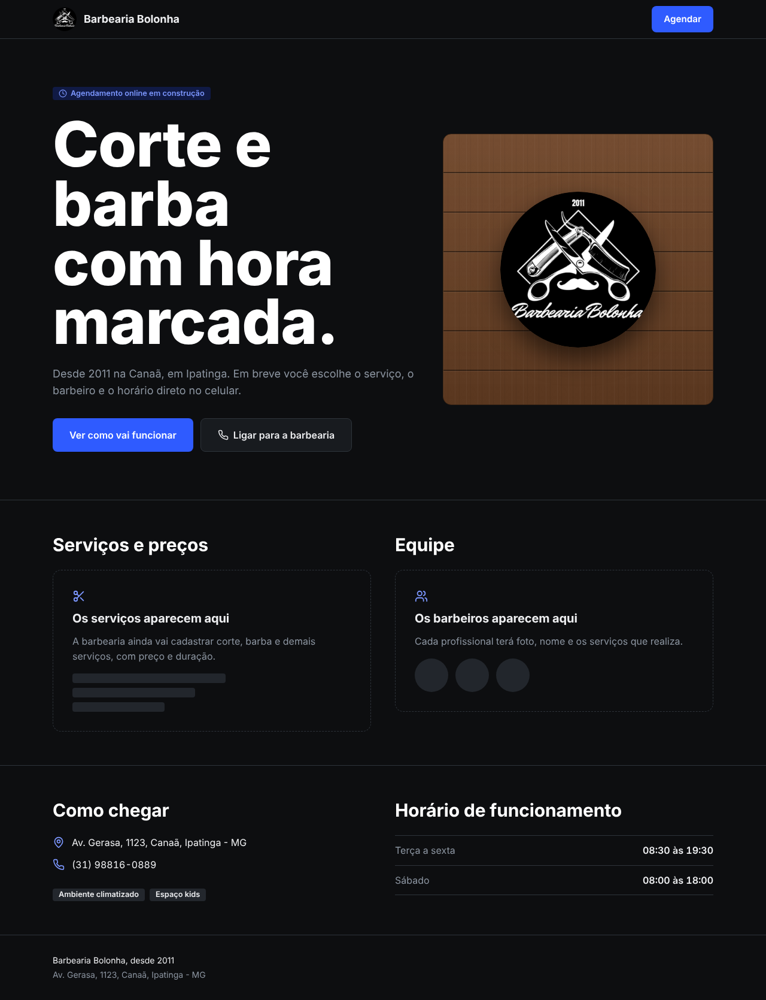
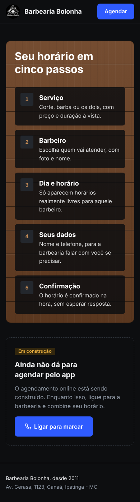
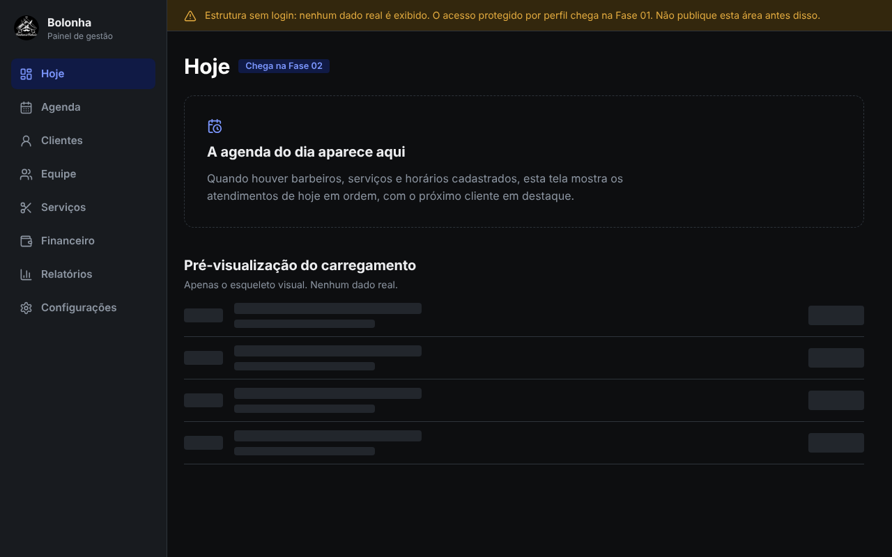

# Design system do Bolonha App

Fonte da verdade dos tokens: `src/app/globals.css` (bloco `@theme`). Este documento explica o porquê; se divergir do CSS, vale o CSS e este arquivo deve ser corrigido.

## 1. Direção

O app público é a **fachada da barbearia**: carvão e grafite do salão, azul como cor de ação, madeira como memória da fachada em ripado. O painel é **ferramenta de trabalho**: mesma paleta, sem ornamento, densidade legível.

Uma única ousadia visual: o **ripado de madeira** (`.ripado`), usado só no site público (painel de passos do agendamento e moldura da logo). Todo o resto é contido: poucas cores, raios pequenos, linhas finas no lugar de sombras.

Fontes de direção: o briefing (paleta e tom) e as fotos da fachada e do salão enviadas (madeira clara e escura, parede grafite com parede laranja-queimada, poltronas pretas, espelhos com luminárias). **O moodboard citado no briefing não chegou** entre os arquivos; esta direção deve ser revisada quando ele for enviado. Nenhuma foto foi incluída no app: as capturas têm interface do Instagram e seriam arquivos inadequados para produção.

> As imagens acima são prévias geradas com o compilador do Tailwind e o Chromium do ambiente, **com Inter no lugar da Archivo** (o ambiente não baixa fontes) e com glifos do conjunto Lucide vindos de `react-icons`, que aproximam os ícones do `lucide-react`, mas não são o pacote real. O título real usa Archivo condensada e fica mais estreito. A logo é **provisória** (recorte de captura de tela; ver pendências). Elas **não** substituem a inspeção com as dependências definitivas.

## 2. Cores

| Token | Hex | Uso |
| --- | --- | --- |
| `carvao` | `#0d0e10` | fundo base |
| `grafite` | `#181b1f` | painéis, barra lateral |
| `grafite-alto` | `#23272d` | hover, skeleton, selos |
| `linha` | `#2e343b` | bordas e divisórias |
| `aco` | `#8c95a1` | texto secundário |
| `osso` | `#edeef0` | texto principal |
| `branco` | `#ffffff` | títulos |
| `azul` | `#2f5bff` | botão primário, destaque |
| `azul-forte` | `#1f43d6` | hover do primário |
| `azul-claro` | `#7c97ff` | texto e ícone azul sobre fundo escuro |
| `azul-fundo` | `#101a45` | fundo de selo informativo e item ativo |
| `madeira` / `madeira-escura` | `#6d4326` / `#3f2714` | só texturas e bordas do ripado |
| `mel` | `#c28a55` | detalhe sobre madeira |
| `sucesso` / `alerta` / `erro` | `#46c487` / `#e3ab3f` | estados; erro `#f06262` |

Regras: azul é a **única** cor de ação; madeira nunca em telas de trabalho; estado nunca depende só de cor (sempre texto ou ícone junto).

### Contraste (calculado com `node scripts/contrast.mjs`, WCAG 2.x)

| Par | Razão | Nível |
| --- | --- | --- |
| osso sobre carvão | 16,63:1 | AAA |
| osso sobre grafite | 14,88:1 | AAA |
| aço sobre carvão / grafite | 6,37:1 / 5,70:1 | AA |
| azul-claro sobre carvão / grafite | 7,11:1 / 6,36:1 | AAA / AA |
| branco sobre azul / azul-forte | 5,17:1 / 7,41:1 | AA / AAA |
| azul-claro sobre azul-fundo | 6,15:1 | AA |
| osso e branco sobre madeira | 7,29:1 / 8,46:1 | AAA |
| mel sobre carvão | 6,49:1 | AA |
| sucesso / alerta / erro sobre carvão | 8,74 / 9,35 / 6,10:1 | AAA / AAA / AA |

Todos os pares usados passam em AA. Texto sobre o ripado fica **sempre** sobre placas `carvao/85` (as emendas das tábuas cortavam o texto na primeira versão).

## 3. Tipografia

Uma família: **Archivo** (variável, eixo de largura `wdth`), carregada por `next/font/google`. A largura faz o papel que seria de uma segunda fonte.

| Classe | Largura / peso | Uso |
| --- | --- | --- |
| `.display` | 72% / 800, entrelinha 0,95 | título principal da home e telas de erro (`clamp(3rem, 9vw, 6.5rem)`) |
| `.titulo` | 85% / 700, entrelinha 1,1 | títulos de seção e cartões |
| corpo | 100% / 400–600, entrelinha 1,55 | texto corrido (16 px) |
| pequeno | `0.8rem`–`0.95rem` | selos, apoio |

Regras: **sentence case** sempre; sem caixa-alta decorativa, sem rótulos sobre títulos, sem destacar uma palavra solta; linhas de texto até 62 caracteres (`.texto-legivel`); números de horário e dinheiro com `.tabular`.

## 4. Espaçamento, raios e elevação

- Escala de 4 px do Tailwind (`1` = 4 px). Seções públicas: `py-12` a `py-20`; conteúdo em `max-w-6xl`, painel em `max-w-5xl`; gutter `px-4` (16 px) no celular e `sm:px-6`.
- Raios: `sm` 4 px (selos, skeleton), `md` 8 px (botões), `lg` 14 px (painéis). Círculo só para avatar/logo.
- Elevação: **por borda e por tom**, não por sombra. Única sombra: a da logo sobre o ripado.

## 5. Estados e feedback

| Estado | Padrão |
| --- | --- |
| Foco | anel `--foco` (azul-claro 55%) em todo elemento interativo (`:focus-visible`) |
| Hover | troca de tom de fundo/borda em 120 ms |
| Pressionado | desloca 1 px para baixo |
| Desabilitado | 45% de opacidade, sem ponteiro |
| Carregando | `Skeleton` com pulso discreto; contêiner com `role="status"`, `aria-busy` e texto para leitor de tela |
| Vazio | `EmptyState`: diz o que falta e o próximo passo; **nunca** dados de exemplo |
| Erro | diz o que houve e como seguir; sem pedido de desculpas e sem detalhe técnico ao cliente |
| Sucesso | confirmação textual com o mesmo verbo da ação (a definir nos formulários da Fase 01) |
| Em construção | `Pill` + flag em `src/config/features.ts`; a interface não finge funcionalidade |

## 6. Ícones

`lucide-react`, traço padrão (2), tamanhos 14 (dentro de selo), 18 a 20 (botões e navegação), 22 (estado vazio). Sempre `aria-hidden` quando há texto ao lado.

## 7. Movimento

Rápido e raro. Transições de 120 ms (interação) e 200 ms (estrutura), curva `--ease-navalha`. Um único movimento orquestrado: o ripado "desce" uma vez ao carregar (`ripado-entra`, 520 ms). Sem animações de entrada em cada seção. `prefers-reduced-motion` desliga tudo.

## 8. Componentes-base

| Componente | Arquivo | Estado |
| --- | --- | --- |
| `Button`, `ButtonLink` (primary, secondary, ghost; md, lg) | `components/ui/button.tsx` | implementado |
| `Pill` (neutral, info, success, warning, danger) | `components/ui/pill.tsx` | implementado |
| `Skeleton` | `components/ui/skeleton.tsx` | implementado |
| `EmptyState` | `components/ui/empty-state.tsx` | implementado |
| `Logo` | `components/brand/logo.tsx` | implementado |
| `SiteHeader`, `SiteFooter`, `OpeningHours` | `components/site/*` | implementado |
| `AdminShell`, `AdminNav`, `AdminPlaceholder` | `components/admin/*` | implementado (sem login) |
| `Field`/`Input`/`Select`, `Dialog`, `Toast`, `Avatar`, `DataTable` | — | Fase 01 |
| `ServicePicker`, `BarberCard`, `SlotPicker`, `DayStrip` | — | Fase 03 |
| `AgendaGrid` (dia/semana), `StatTile` | — | Fases 02 e 06 |

## 9. Uso da logo

- Arquivo atual `public/brand/logo-bolonha-circulo.png` (700×700): **recorte da captura de tela do perfil**, sem redesenho. É **provisório**; trocar pelo original e atualizar `src/config/brand.ts`.
- Só escala proporcional. Não recriar com texto, não recolorir, não distorcer, não cortar.
- Sobre fundo claro ou madeira, manter o círculo preto da própria logo (ele já é a base).
- Os ícones do PWA (`public/icons/*`) são a mesma logo redimensionada; versão "maskable" definitiva na Fase 07.

## 10. Acessibilidade

Contraste AA no mínimo; foco visível; alvos de toque ≥ 44 px (botões `h-11`/`h-14`); navegação por teclado; `lang="pt-BR"`; `prefers-reduced-motion` respeitado; `aria-current="page"` na navegação. Pendente: teste com leitor de tela e auditoria automatizada (Fase 07).

## 11. Regras de ouro

1. Cor, raio e fonte só entram por token; nada de hex solto em componente (exceção atual: fundos de `Pill` de estado e do aviso do painel, a promover a tokens na Fase 01).
2. CSS próprio vive em `@layer components`; senão ele vence os utilitários do Tailwind (bug real encontrado na prévia).
3. Tela pública: poucas decisões, um caminho. Tela de trabalho: informação primeiro.
4. Nenhum dado fictício apresentado como real.
